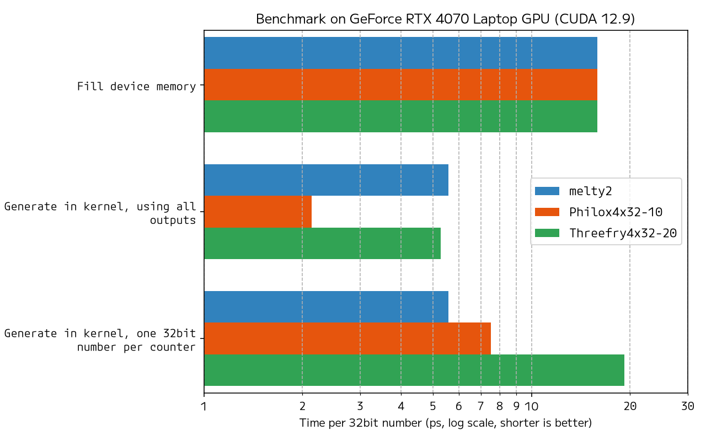
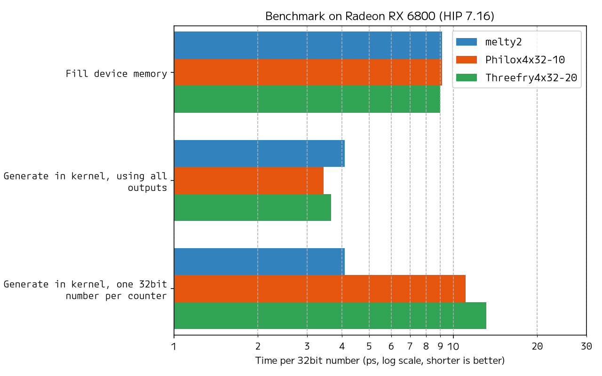
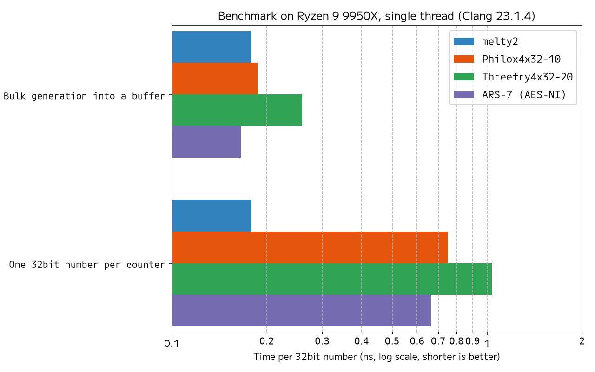

# Melty2

**Fast, portable and easy-to-use counter-based pseudo-random number generator** for accelerators and CPUs, written in C99 with a C++ wrapper. Each 32bit output is a pure function of a 192bit key and a 64bit counter: `out = f(key, ctr)`.

**Being counter-based, it needs no mutable state, so it is much easier to use in parallel than common generators.**

* **Parallel streams without coordination.** Give each thread its own seed, or its own counter range under a shared seed. No jump-ahead tables nor stream splitting is required.
* **Random access.** Any position of the stream is computed directly, so skipping, rewinding and partitioning work into chunks are trivial.
* **Reproducibility independent of parallelism.** The value for a given (seed, counter) never depends on the number of threads, the scheduling, or the vector width, so a simulation gives bitwise identical results on different machines, e.g. on a CPU and on a GPU running the same kernel.
* **Tiny footprint.** Only the 192bit key and the counter have to be held, and the counter is often derived from indices already at hand (e.g. particle ID and time step). Taking a snapshot or a checkpoint of the generator is just saving the counter.

**It uses only 32bit additions, xors and rotations (ARX), and no multiplication.** One output costs only 20 ARX steps, so it runs efficiently on GPUs and on processors without an integer multiplier. The C library dispatches SIMD implementations (AVX-512, AVX2, SSE2, SVE and NEON) at runtime, and a header-only implementation for CUDA and HIP is also provided. The statistical quality is checked by PractRand, TestU01 BigCrush and the Hamming-weight dependency test, including keys with structure (see [Algorithm detail](#algorithm-detail)).

**Melty2 is not a cryptographically secure generator.** It is designed for simulations and tests, where statistical quality, speed and reproducibility matter, and its outputs may be predictable to an adversary. Don't use it for keys, nonces, tokens, passwords or anything security-sensitive; use the random source of the OS (e.g. `getrandom`) or a cryptographically secure generator instead.

Its name derives from *melting* in Isaac Asimov's novel *The Gods Themselves*, where three beings of the para-universe merge into one. Melty2 merges six 32bit words, twice as many as the three beings.

## Usage

### C

Build and install the library by CMake, then include `melty2.h`.

```c
#include <stdio.h>
#include "melty2.h"

int main(void) {
    melty2_key key;
    melty2_init(&key, 0, 0, 0, 0);  /* 128bit seed */
    uint32_t r[8];
    melty2_gen(&key, 0, 8, r);      /* outputs for counters 0, 1, ..., 7 */
    printf("%08x\n", r[0]);         /* prints 008ae4d0 */
    return 0;
}
```

It provides the following functions.

```c
void melty2_init(melty2_key *key, uint32_t seed0, uint32_t seed1, uint32_t seed2, uint32_t seed3);
void melty2_init_u64(melty2_key *key, uint64_t seed0, uint64_t seed1);
void melty2_gen(const melty2_key *key, uint64_t ctr, size_t len, uint32_t *out);
```

`melty2_init` takes a 128bit seed as four 32bit integers, lower ones first, and stretches it to a key by a cryptographic algorithm, so even similar seeds (e.g. thread IDs) yield unrelated keys. `melty2_init_u64` takes the same seed as two 64bit integers; for example, `melty2_init_u64(&key, 42, 0)` is the same as `melty2_init(&key, 42, 0, 0, 0)`.

`melty2_gen` stores `len` numbers for the counters `ctr`, `ctr + 1`, ... to `out`. The counter wraps around after 2^64 - 1.

For advanced users, the low-level function generating a block of `MELTY2_RAWBLKLEN` (32) numbers is also provided.

```c
void melty2_rawblkgen(const melty2_key *key, uint32_t ctr_lo, uint32_t ctr_hi, uint32_t *out);
```

The counter is given by its lower and upper 32bit. As the carry from the lower to the upper is not handled, `ctr_lo` must not exceed `2^32 - MELTY2_RAWBLKLEN`. `melty2_gen` is built on this function, and handles any counter range.

### C++

`melty2.hpp` provides `melty2::generator`, which satisfies the UniformRandomBitGenerator requirements.

```cpp
#include <cstdint>
#include <iostream>
#include <random>
#include "melty2.hpp"

int main() {
    /* 128bit seed as four 32bit integers, lower ones first */
    melty2::generator gen{{3141592653u, 2718281828u, 123456789u, 42u}};

    /* usable with the distributions of <random> */
    std::uniform_real_distribution<double> dist{0.0, 1.0};
    std::cout << dist(gen) << std::endl;

    /* 64bit seed; the same as the 128bit seed {(uint32_t)seed, seed >> 32, 0, 0} */
    melty2::generator gen64{UINT64_C(0x0123456789abcdef)};

    /* 128bit seed as two 64bit integers, lower one first; the same as melty2_init_u64 */
    auto gen128 = melty2::generator::from_u64_seeds(UINT64_C(0x0123456789abcdef), UINT64_C(0xfedcba9876543210));

    /* the initial counter can be given as the last argument of any of the above (0 by default) */
    melty2::generator gen_at{UINT64_C(42), 1000};

    /* the counter can be read and set; jumping ahead costs nothing more than generating one block */
    std::cout << gen_at.ctr() << std::endl;  /* prints 1000 */
    gen_at.ctr(UINT64_C(1) << 40);

    std::cout << gen64() << ' ' << gen128() << ' ' << gen_at() << std::endl;
}
```

### GPU (CUDA and HIP)

`melty2_gpu.h` is a header-only implementation for CUDA and HIP. It doesn't require linking the library, and its outputs are identical to those of the CPU library for the same seed and counter.

To fill device memory with random numbers, use `fill`, which is the GPU counterpart of `melty2_gen`.

```cpp
#include "melty2_gpu.h"

const melty2_key key = melty2::gpu::init(seed0, seed1, seed2, seed3);
/* launch a kernel storing the numbers for counters 0, 1, ..., n - 1 to the device memory out */
auto err = melty2::gpu::fill(key, 0, n, out);  /* cudaSuccess or hipSuccess if launched */
```

It runs asynchronously on the stream given as the optional last argument, and returns the error of the kernel launch. The types of the stream and the error are `cudaStream_t` and `cudaError_t` for CUDA, or `hipStream_t` and `hipError_t` for HIP.

To generate numbers in your own kernel, the simplest way is that all threads share a key, and each thread uses its own range of counters, e.g. with the thread ID in the upper 32bit of the counter. Each number costs only 20 ARX steps.

```cpp
#include "melty2_gpu.h"

__global__ void simulate(melty2_key key, float *out) {
    const uint32_t tid = blockIdx.x * blockDim.x + threadIdx.x;
    /* the upper 32bit of the counter is the thread ID, and the lower 32bit counts the numbers of the thread */
    melty2::gpu::generator gen(key, (uint64_t)tid << 32);
    float sum = 0.0f;
    for (int i = 0; i < 100; ++i) {
        sum += (gen() >> 8) * (1.0f / 16777216.0f);  /* uniform in [0, 1) */
    }
    out[tid] = sum;
}

/* on the host: derive one key, and pass it to the kernel */
const melty2_key key = melty2::gpu::init(seed0, seed1, seed2, seed3);
simulate<<<blocks, threads>>>(key, out);
```

If the counter is given by the index of a work item instead of the thread ID, e.g. `melty2::gpu::gen(key, (uint64_t)item << 32 | i)` for the `i`-th number of the work item `item`, the result doesn't depend on how the work items are assigned to threads.

Alternatively, each thread can derive its own key from a seed containing the thread ID, e.g. `melty2::gpu::generator gen(seed, tid, 0, 0)`. This is useful when it is hard to assign counter ranges in advance, e.g. when the work is divided among threads irregularly, or the division changes during the program. In such cases, a seed containing the ID of a logical unit (such as a particle or a task) instead of the thread ID gives each unit its own stream regardless of the division, and the whole 64bit counter remains available for the numbers of the unit. The key derivation computes one ChaCha8 block (384 ARX operations) once per thread, which takes about as long as generating 10 numbers (9.7 on GeForce RTX 4070 Laptop GPU).

It provides the following functions and class in the namespace `melty2::gpu`, all of which are callable from both host and device code except `fill`.

```cpp
melty2_key init(uint32_t seed0, uint32_t seed1, uint32_t seed2, uint32_t seed3);  /* same as melty2_init */
melty2_key init_u64(uint64_t seed0, uint64_t seed1);  /* same as melty2_init_u64 */
uint32_t gen(const melty2_key &key, uint64_t ctr);  /* the number for the counter */
class generator;  /* holds a key and a counter; constructed from a key, four 32bit seeds or a 64bit seed */
error_t fill(const melty2_key &key, uint64_t ctr, size_t len, uint32_t *out, stream_t stream = 0);
```

In a CMake project, link the `melty2_gpu` target, which only adds the include directory.

### Build

```sh
git clone --recursive https://github.com/grafi-tt/melty2.git
cd melty2
cmake -S . -B build -DCMAKE_BUILD_TYPE=Release
cmake --build build
ctest --test-dir build
cmake --install build --prefix /usr/local
```

Then use it from another CMake project by `find_package(melty2)` and `target_link_libraries(your_target PRIVATE melty2)` (or `melty2_gpu` for the GPU header), or add this repository by `add_subdirectory`.

The following options are available.

* `BUILD_SHARED_LIBS` (default `OFF`): build a shared library.
* `MELTY2_ENABLE_CPU_FEATURES` (default `ON`): select the SIMD implementation at runtime by [cpu_features](https://github.com/google/cpu_features). If disabled, only the generic implementation is built.
* `MELTY2_ENABLE_TEST` (default `ON`): build tests.
* `MELTY2_ENABLE_BIGCRUSH` (default `OFF`): build the BigCrush runner, which requires TestU01.
* `MELTY2_ENABLE_BENCHMARK` (default `OFF`): build the CPU benchmark `bench_cpu`, compiled with `-march=native` for GCC and Clang.
* `MELTY2_GPU_TEST` (default empty): build the GPU test by `CUDA` or `HIP`, which requires CMake 3.21. Set `CMAKE_CUDA_ARCHITECTURES` or `CMAKE_HIP_ARCHITECTURES` as needed.
* `MELTY2_GPU_BENCHMARK` (default empty): build the GPU benchmark `bench_gpu` by `CUDA` or `HIP`, which requires CMake 3.21.

### TIPS: Independent generators for tests

A counter-based generator makes it easy to give every test its own independent random numbers while keeping them reproducible. Hash the test name into a part of the 128bit seed, and put a global seed into the rest.

```cpp
#include <cstdint>
#include <string_view>
#include "melty2.hpp"

/* FNV-1a 64bit hash; a simple hash suffices, as melty2_init decorrelates similar seeds */
constexpr uint64_t fnv1a64(std::string_view s) {
    uint64_t h = 0xcbf29ce484222325;
    for (char c : s) {
        h ^= static_cast<unsigned char>(c);
        h *= 0x00000100000001b3;
    }
    return h;
}

melty2::generator test_rng(uint64_t global_seed, std::string_view test_name) {
    return melty2::generator::from_u64_seeds(global_seed, fnv1a64(test_name));
}

/* in each test */
auto rng = test_rng(global_seed, "sort/random_ints");
```

* Each test gets numbers unrelated to those of the other tests. It avoids the common pitfall of initializing a generator with the same seed at the beginning of every test, where all tests silently consume the same random sequence.
* The numbers of a test don't depend on which tests run before it, or on the order or the parallelism of the test runner. So a failed test can be reproduced alone.
* Changing the global seed (e.g. by an environment variable or a command line option) runs all the tests with different random inputs, and the seed printed on failure reproduces it.

## Output stability

The outputs for a given seed and counter are a part of the specification. They don't change within a major version, so a result can be reproduced by any build of the same major version on any platform. Any change of the outputs, e.g. by a change of the kernel or the key derivation (including rejecting weak keys in the future), is made only in a new major version. The development versions before 1.0.0 produce different outputs.

The following known-answer vectors are for checking other implementations and ports. Seeds are given as the arguments of `melty2_init`, and keys are the six 32bit words `v[0..5]` described in [Algorithm detail](#algorithm-detail).

```
seed 00000000 00000000 00000000 00000000
key  c30e842c 3b7f9ace 88e11b18 1e1a71ef 72e14c98 416f21b9
  counter 0, 1, ..., 7          008ae4d0 ca526536 795aec72 ae2f853d 0efca306 d9ddd678 4e83cc9f d53cc98f
  counter 0xffffffff            0ae8a21f
  counter 0x100000000           d5ecaa16
  counter 0xffffffffffffffff    f82ad70e

seed 00000001 00000002 00000003 00000004
key  1e444cd1 fbc46f8f b288d91b 665b68cf 26d92a11 f1beebf6
  counter 0, 1, 2, 3            4072f684 02971477 fddc8798 d376f585

seed 89abcdef 01234567 fedcba98 76543210   (melty2_init_u64 with 0x0123456789abcdef, 0x76543210fedcba98)
key  2a333ca4 8f796a69 04a1065b 8458d96d 329e894d 9387f08e
  counter 0, 1, 2, 3            4b0d0558 5663812d 79a140c2 c6e3bf39
```

## Benchmark

### GPU

The following results compare melty2 with Philox4x32-10 and Threefry4x32-20 on GeForce RTX 4070 Laptop GPU (Ada, sm_89), compiled by CUDA 12.9 with `CMAKE_BUILD_TYPE=Release` ([results](bench/bench_result); `bench_gpu 42`, starting from the counter 42, built with `MELTY2_GPU_BENCHMARK=CUDA`). As in the CPU benchmark, Philox and Threefry are implemented for the benchmark following their specifications, and verified by the known-answer test vectors of Random123. Each benchmark generates 2^28 numbers. melty2 fills device memory by `melty2::gpu::fill`, and the others by a kernel with the same launch configuration, which writes each 128bit block by one store. When generating numbers in a kernel, each of 2^20 threads xors the numbers for its own range of counters, and writes only the result to memory. Unlike the CPU benchmark, the time for one 32bit number per counter is measured directly by a kernel using only the first word of each block.



| Benchmark | melty2 | Philox4x32-10 | Threefry4x32-20 |
|---|---|---|---|
| Fill device memory | 62.9 Gnum/s (251 GB/s) | 62.8 Gnum/s (251 GB/s) | 62.8 Gnum/s (251 GB/s) |
| Generate in kernel, using all outputs | 179 Gnum/s | 468 Gnum/s | 189 Gnum/s |
| Generate in kernel, one 32bit number per counter | 179 Gnum/s | 133 Gnum/s | 52.0 Gnum/s |

* Filling memory is limited by the memory bandwidth for all of them (`memset` achieves 251 GB/s).
* When all outputs are used, Philox is 2.6 times faster than melty2. The throughput roughly follows the number of instructions in the generated code: one 32bit number takes about 11.5 instructions for Philox, and about 37.5 and 35.5 for melty2 and Threefry respectively. On this GPU, 32bit multiplications run at a throughput comparable to additions, xors and rotations.
* When only one 32bit number is needed for each counter (e.g. random access, or a single draw per particle), melty2 is 1.4 times faster than Philox and 3.5 times faster than Threefry, as the others compute most of a 128bit block for each number.
* Deriving keys from seeds runs at 18.5 Gkey/s, i.e. a key takes as long as 9.7 numbers to generate, so it is negligible when a thread uses hundreds of numbers or more.

The following results are on AMD Radeon RX 6800 (RDNA2, gfx1030) by the same benchmark, compiled by HIP 7.16 (Clang 23.1.4) with `CMAKE_BUILD_TYPE=Release` and `CMAKE_HIP_ARCHITECTURES=gfx1030` (`bench_gpu 42`, built with `MELTY2_GPU_BENCHMARK=HIP`).



| Benchmark | melty2 | Philox4x32-10 | Threefry4x32-20 |
|---|---|---|---|
| Fill device memory | 110 Gnum/s (438 GB/s) | 110 Gnum/s (438 GB/s) | 111 Gnum/s (445 GB/s) |
| Generate in kernel, using all outputs | 244 Gnum/s | 291 Gnum/s | 274 Gnum/s |
| Generate in kernel, one 32bit number per counter | 244 Gnum/s | 90.2 Gnum/s | 76.1 Gnum/s |

* Filling memory is limited by the memory bandwidth for all of them (`memset` achieves 492 GB/s).
* When all outputs are used, Philox and Threefry are 1.2 and 1.1 times faster than melty2 respectively. One 32bit number takes about 10.75 vector instructions for Philox, and about 34.5 and 30.75 for melty2 and Threefry respectively. Philox has 3.2 times fewer instructions than melty2 but is only 1.2 times faster, presumably because its 32bit multiplications (4.75 instructions, each giving both halves of a 64bit product) have a lower throughput than additions, xors and rotations on this GPU.
* When only one 32bit number is needed for each counter, melty2 is 2.7 times faster than Philox and 3.2 times faster than Threefry.

### CPU

The following results compare melty2 with Philox4x32-10, Threefry4x32-20 and ARS-7 (with AES-NI) on Ryzen 9 9950X (Zen 5, AVX-512) in a single thread, compiled by Clang 23.1.4 with `-O3 -march=native` ([results](bench/bench_result); `bench_cpu 42`, starting from the counter 42, built with `MELTY2_ENABLE_BENCHMARK`). The numbers of rounds are those proposed by Salmon et al. melty2 is measured by `melty2_gen` of the library. The other generators are implemented for the benchmark following their specifications, and verified by the known-answer test vectors of Random123. Like melty2, they compute 32 counters at a time by a plain loop, which the compiler vectorizes, except ARS, which computes each block by AES-NI. The time for one 32bit number per counter is that for a block, i.e. the time of the bulk generation multiplied by the number of 32bit words in a block (1 for melty2 and 4 for the others). This assumes that a whole block is computed for each number. When only one word of a block is used, the compiler may omit a part of the computation for the other words, so the actual time of Philox and Threefry may be considerably shorter; ARS computes the whole block by AES instructions in any case.



| Benchmark (ns per 32bit number) | melty2 | Philox4x32-10 | Threefry4x32-20 | ARS-7 |
|---|---|---|---|---|
| Bulk generation into a buffer | 0.179 | 0.188 | 0.259 | 0.166 |
| One 32bit number per counter | 0.179 | 0.752 | 1.036 | 0.663 |

* In bulk generation, melty2, Philox and ARS are about as fast, as they use all outputs of each block, and Threefry is about 1.4 times slower. ARS is slightly faster with the dedicated AES instructions.
* When only one 32bit number is needed for each counter, melty2 is 3.7 to 5.8 times faster than the others by this estimate, as they compute a block of 128bit and discard the rest.

## Similar projects

### Counter-based generators

* [Random123](https://dl.acm.org/doi/10.1145/2063384.2063405) (Philox, Threefry, ARS)

  Philox is excellent, but it relies on 32x32→64bit multiplications, and produces 128bit per call while the latency to obtain a 32bit output is long. Threefry is ARX-based, derived from the Threefish block cipher used in the Skein hash function, but has a 256bit or 128bit state and more rounds. ARS uses 7 rounds of AES with a simplified key schedule, which is very fast with AES instructions (AES-NI, ARMv8 Crypto Extension), but they are unavailable on GPUs and many accelerators.

  Philox and Threefry are widely used, e.g. Philox in cuRAND, PyTorch and NumPy, and Threefry as the default of JAX.

* Weyl sequence based generators: [SplitMix64](https://dl.acm.org/doi/10.1145/2660193.2660195), [rapidrand](https://docs.rs/rapidrand/latest/rapidrand/)

  They compute the `n`-th number as `mix(seed + n * gamma)`, so they allow random access like counter-based generators, and they are very fast on CPUs. However, the mixing relies on 64bit (or 64x64→128bit for rapidrand) multiplications. Moreover, when streams differ only by the seed, they are offsets on a single cycle of length 2^64, so the streams of many threads may overlap.

* [Squares](https://arxiv.org/abs/2004.06278)

  A counter-based generator based on the middle-square method, which relies on 64bit multiplications.

* [ChaCha](https://cr.yp.to/chacha.html) (as used by e.g. [rand_chacha](https://crates.io/crates/rand_chacha))

  ChaCha with 8, 12 or 20 rounds is a cryptographically strong counter-based generator. As one block yields 512bit, it is efficient for bulk generation, but costly when only a single 32bit number is needed.

### Other fast generators

* [xoshiro / xoroshiro](https://prng.di.unimi.it/)

  Very good generators, while assigning streams to many threads requires jump-ahead to be used correctly.

## Algorithm detail

### What is a counter-based generator

Most generators, such as Mersenne Twister, xoshiro and PCG, hold a state, and produce each number by updating the state and applying an output function to it. The update is cheap, but the numbers must be produced in sequence. To use them in parallel, the stream has to be split, for example by jump-ahead functions, and each thread has to hold its own state.

A counter-based generator (Salmon et al., [*Parallel random numbers: as easy as 1, 2, 3*](https://dl.acm.org/doi/10.1145/2063384.2063405), SC'11) instead computes the `n`-th number directly as `f(key, n)`, where `f` is a fixed mixing function like a reduced-round block cipher. The key selects a stream, and the counter selects a position in it. Nothing is updated, so an arbitrary number of threads can compute any of the numbers independently.

The price is that every number has to go through the whole mixing function, while a state-based generator mixes its state only a little per number. So the mixing function must be designed to be both cheap and strong enough: the outputs for counters close to each other (differing in a few bits, or by a small integer) must look unrelated. Melty2 achieves this with 20 ARX steps for each 32bit number, and the counter-differential metric described below measures exactly this property.

### Key derivation

The 192bit melty2 key consists of the words 4 to 9 of the [ChaCha8](https://cr.yp.to/chacha.html) block, where the ChaCha key is zero and the 128bit seed is given as the counter and nonce. ChaCha8 uses only 32bit ARX operations, so its implementation is straightforward on GPUs and processors without 64bit arithmetic. As ChaCha8 is a well-trusted cipher, its outputs can be regarded as uniform. Thus keys of distinct seeds are independent, and keys related to each other appear only with a negligible probability.

### Kernel

The key consists of six 32bit words `v[0..5]`. The 64bit counter `(hi, lo)` is injected as

```c
v[0] ^= lo; v[1] += hi; v[2] ^= hi; v[3] += lo;
```

and then 20 ARX steps (7 additions, 3 xors and 10 xor-rotations) are applied, where the last written word is the output. See [`src/melty2_kernel.h`](src/melty2_kernel.h) for the exact definition.

The kernel consists of two phases.

* In the first half (steps 1 to 11), all the six words are mixed together. The words `v[0..3]`, into which the counter is injected, are mixed first. Then `v[5]` and `v[4]` are absorbed by additions, so that every key word affects the remaining state.
* In the second half (steps 12 to 20), the state is narrowed down to the four words `v[0]`, `v[1]`, `v[3]` and `v[5]` (`v[2]` is only read once, and `v[4]` is no longer used). As each step updates one of the four words, every word is updated more frequently than in a six-word state, which yields stronger diffusion per step toward the output.

These steps are almost sequential: with bitwise rotation instructions, the kernel including the counter injection consists of 34 instructions, and its critical path spans 31 of them. This is intended, as a sequential dependency mixes the state more thoroughly than independent operations do. Instruction-level parallelism is not essential, since the outputs for multiple counters can be computed in parallel by SIMD lanes or GPU threads. This also suits accelerators whose cores are not superscalar.

The original kernel designed by the author had 22 steps. It was shortened to 20 steps by Claude Opus 5.5 (Anthropic) through a structure search, which minimizes a counter-differential bias metric at reduced depths, under the constraints that every operation affects the output and every key word passes through an addition. The metric compares outputs for counters `c` and `c + 2^j` at each intermediate step; the bias vanishes 4 steps before the output for random keys, while it does 2 to 3 steps before the output for the original 22-step kernel. See [doc/kernel_search.md](doc/kernel_search.md) for the details of the search and the evaluation, and [search/](search/) for its tools.

### Weak keys

When each of a huge number of threads uses its own seed, a key with some structure, such as a zero word, appears with a non-negligible probability. Such keys were first tested by the differential metric on GPU, and then by PractRand on the least significant bits on CPU. After that, heavier tests were performed: PractRand on the full outputs, and a subset of BigCrush.

The weak keys considered are as follows:

* a zero, all-one or Hamming weight 1 word,
* equal, negated, MSB-flipped or rotated word pairs,
* zero half-words in multiple words, low Hamming weight word pairs, and near-equal word pairs.

The most sensitive case is that `v[4]` and `v[5]`, which the counter is not injected to and which are absorbed only by a few steps of the first half, are sparse at the same time. Even then the bias vanishes 3 steps before the output. Relations between words (equal, rotated, negated or near-equal pairs) and sparse `v[0..2]` are as harmless as random keys.

### Statistical tests

* PractRand: passed up to 64GB for multiple seeds, both counter orders (lower or upper 32bit of the counter incrementing first) and weak keys ([results](practrand_result)).
* TestU01 BigCrush: passed for the seeds 0 to 15 with both counter orders ([results](bigcrush_result); `run_bigcrush SEED`, built with `MELTY2_ENABLE_BIGCRUSH`, and also `MELTY2_INTERNAL_SWAP32_CTR` for the other counter order). 8 of the about 5000 p-values are outside [0.001, 0.999], as many as expected by chance, and the two smallest ones (1.1e-6 and 9.0e-6) were not reproduced by 10 reruns of the tests on the following outputs.
* [Hamming-weight dependency test](https://prng.di.unimi.it/hwd.php): passed up to 10^14 bytes with both counter orders ([results](hwd_result)). Reduced to 17 steps, the kernel is detected at about 3 × 10^13 bytes in the default counter order.

## License

Melty2 is dedicated to the public domain under [CC0 1.0](LICENSE). [cpu_features](third_party/cpu_features) is distributed under the Apache License 2.0 ([LICENSE.cpu_features](LICENSE.cpu_features)).
